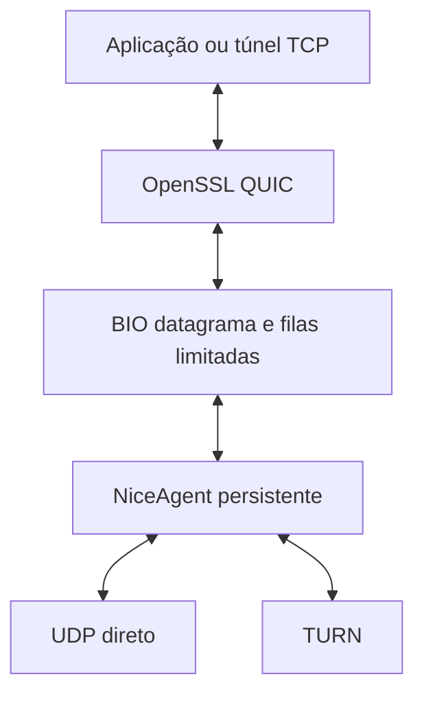
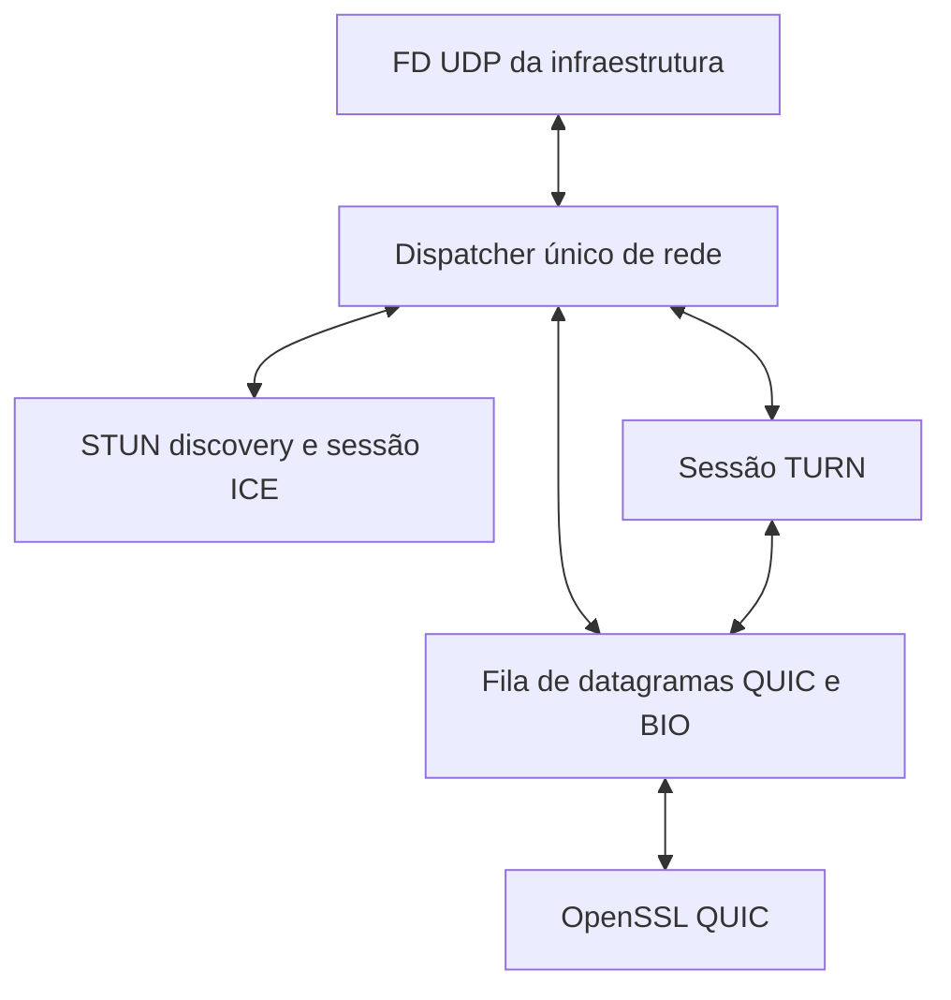

# Integração ICE persistente com QUIC

Análise de 2026-10-29. Base local: commit `5b1f2f6`, working tree limpo antes
desta documentação. Foram examinados fontes, experimento preservado e fontes
primárias das bibliotecas. Não foi executada uma nova prova de integração.

## Recomendação e requisito de socket

A opção de manter ICE ativo é a mais adequada ao objetivo de suportar relay e
recuperar conectividade. A escolha da biblioteca depende de quem deve possuir o
socket. **Libnice é a primeira candidata se puder criar e controlar os sockets;
PJNATH de baixo nível merece a primeira prova se o FD criado pela infraestrutura
for requisito obrigatório.** Não assumir que libnice adota um FD arbitrário.

O usuário esclareceu que prefere criar o FD na infraestrutura, usar o mesmo
socket para ICE e QUIC e demultiplexar os pacotes. É importante separar:

| Requisito | Libnice pública | Consequência |
| --- | --- | --- |
| Aplicação escolhe endereços e portas | Sim | Configurar antes de coletar candidatos. |
| Aplicação ajusta sockets criados pelo agente | Sim, por `get_sockets()` | Opções que precisam preceder `bind()` não ficam automaticamente disponíveis. |
| Aplicação entrega FD já criado/bound ao agente | Não foi encontrada API pública | Não atendido sem mudar o desenho ou a biblioteca. |
| Mesmo transporte físico carrega ICE e QUIC | Sim, QUIC como payload da ICE | Não exige que OpenSSL leia diretamente o FD. |

A distinção vem dos contratos de [endereços/portas/sockets e I/O de
NiceAgent](https://raw.githubusercontent.com/libnice/libnice/master/agent/agent.h). A ausência de
adoção de FD é resultado da inspeção da API pública consultada, não afirmação
sobre impossibilidade de um fork.

Reutilizar o socket não exige dois leitores. Deve existir **um único dono da
recepção**, que encaminha controle STUN/TURN ao ICE e datagramas QUIC ao OpenSSL.
`dup(fd)` preserva o mesmo socket e a mesma fila de recepção; não cria uma fila
por protocolo. Dois `recv()` independentes podem consumir o pacote um do outro.

## As duas opções não têm o mesmo alcance

| Aspecto | ICE inicial e handoff | ICE persistente |
| --- | --- | --- |
| Estabelecimento | Coleta, troca, checks e seleção antes de sair do ICE | Mesmas etapas iniciais |
| Posse após estabelecer | Aplicação/protocolo assume socket direto | Agente ou dispatcher mantém controle do transporte |
| NAT após estabelecer | Protocolo/aplicação precisa manter caminho | ICE continua manutenção; QUIC continua seus próprios timers |
| TURN | Handoff simples de FD não preserva cliente TURN | Cliente TURN ativo encapsula dados e renova estado |
| Novos candidatos/restart | Exige reconstruir negociação | Há APIs/estado para recuperação coordenada |
| Custo | Menos dependências no processo final | Mais integração de I/O, estado, timers e filas |
| Continuidade do QUIC | Caminho inicial fixo | Precisa provar continuidade ao mudar caminho |

Obter candidatos não significa concluir hole punching. É necessário trocar
credenciais/candidatos, testar pares e selecionar um caminho utilizável. O
servidor STUN não substitui signaling. Referência: [RFC 8445, visão geral e
restart](https://www.rfc-editor.org/rfc/rfc8445.html#section-2).

No handoff, endereço público descoberto para um socket não torna um socket novo
equivalente. É preciso preservar o socket/caminho efetivamente validado e retirar
o antigo consumidor antes de iniciar o novo.

### O que o experimento de 25/10 comprovou

[VALIDATION.md](../experiments/ice-handoff-2026-10-25/VALIDATION.md) registra
libnice **0.1.21**, um componente UDP/IPv4 e handoff para **CHOWNAT**. Em
`launcher.c:76–100`, consulta o par, rejeita candidato relay local ou remoto,
duplica o FD, desliga recepção e destrói NiceAgent antes de `exec()`.

Foram validados UDP com três rodadas e TCP com 16 KiB antes e depois de pausa de
20 s, NAT com timeout de 8 s e controle negativo sem keep-alive. Não foram
validados QUIC/OpenSSL, TURN, migração, restart ou ICE persistente. O experimento
é evidência útil do handoff direto, não prova da arquitetura proposta aqui.

O [contrato de get_selected_socket](https://libnice.freedesktop.org/libnice/NiceAgent.html#nice-agent-get-selected-socket)
prevê esse uso legado. A [implementação](https://raw.githubusercontent.com/libnice/libnice/master/agent/agent.c)
não fornece socket transferível quando o candidato **local** selecionado é
relay, nem para reliable/ICE-TCP. Um relay apenas remoto não implica a mesma
restrição do socket local; o experimento excluiu ambos como simplificação.
Duplicar FD não transfere lógica de allocations, permissões ou channels TURN.

## Bibliotecas

| Biblioteca | Ajuste ao projeto | FD externo | Recuperação e TURN | Recomendação |
| --- | --- | --- | --- | --- |
| libnice | C, GLib/GObject, APIs de datagramas | Sem adoção pública encontrada | Trickle, restart; TURN UDP/TCP/TLS; recuperação exige política | Preferida se a posse do socket puder ficar com ICE |
| PJNATH, `pj_ice_sess` | C, sessão ICE independente do transporte | Aplicação faz I/O por callbacks | Compor ICE, STUN discovery e TURN de baixo nível; validar recuperação/consent na versão fixada | Preferida para a prova de FD próprio |
| libjuice | C11, integração menor | Sem adoção pública encontrada | Consent e trickle; código consultado rejeita restart; TURN/UDP | Boa para escopo mais estático; não primeira escolha aqui |
| libdatachannel | C++ com API C de PeerConnection/DataChannel | Sem solução pública direta para este requisito | Usa libjuice ou libnice como backend | Acrescenta pilha WebRTC além do necessário para nosso QUIC |

Fontes por biblioteca: [libnice](https://libnice.freedesktop.org/),
[ICE session PJNATH](https://docs.pjsip.org/en/2.17/api/generated/pjnath/group/group__PJNATH__ICE__SESSION.html),
[header libjuice](https://raw.githubusercontent.com/paullouisageneau/libjuice/master/include/juice/juice.h),
[restrições de restart libjuice v1.7.4](https://raw.githubusercontent.com/paullouisageneau/libjuice/v1.7.4/src/agent.c),
[API libdatachannel](https://github.com/paullouisageneau/libdatachannel/blob/master/DOC.md).
As conclusões sobre master descrevem a revisão consultada; devem ser
reconfirmadas na tag/commit escolhido para o experimento.
Os detalhes de implementação libnice foram inspecionados em master, sem pinagem
de hash nesta análise; reconfirmar na tag escolhida antes da prova. A restrição
de restart libjuice foi também conferida na tag v1.7.4.

### Libnice: maturidade e limites concretos

O projeto declara interoperabilidade com implementações WebRTC; há testes
específicos de restart, trickle, TURN, consent, interfaces e portas. Isso
sustenta maturidade de ICE, sem provar nossa composição com OpenSSL.
Fontes: [projeto](https://libnice.freedesktop.org/),
[suíte oficial](https://raw.githubusercontent.com/libnice/libnice/master/tests/meson.build).

A release listada atualmente é **0.1.24**, de 01/09/2026. O experimento antigo
usou 0.1.21. O NEWS registra correções posteriores de consent, sockets TURN e
TURN sobre TCP; o próximo ensaio deve fixar uma versão mantida e registrar
dependências. A presença de 0.1.24.1 em master não o transforma em release.
Fonte: [NEWS](https://raw.githubusercontent.com/libnice/libnice/master/NEWS).
Os headers OpenSSL locais consultados dizem **4.1.0-dev**, não uma release
estável comprovada; registrar também hash/build dessa dependência.

Manter o agente vivo fornece mecanismos, não uma política universal de troca de
rede. A inspeção de [agent.c](https://raw.githubusercontent.com/libnice/libnice/master/agent/agent.c)
e [stream.c](https://raw.githubusercontent.com/libnice/libnice/master/agent/stream.c)
mostra que nova chamada de gather pode retornar por coleta já iniciada e restart
não equivale a recriar todos os candidatos locais. Nova interface/IP precisa de
tratamento da aplicação; uma nova stream/agente é a abordagem conservadora a
testar. Adicionar TURN tardiamente é contemplado no código, mas requer validar
descoberta, signaling, seleção e latência de recuperação.

`nice_agent_set_selected_pair()` não é o mecanismo para failover automático:
sua documentação desliga processamento ICE posterior. `support-renomination`
também não deve ser tratado como promessa de migrar qualquer par por iniciativa
local. APIs de restart, novos candidatos, perda de consent e seleção precisam
ser combinadas com uma máquina de estados da aplicação. Fonte:
[contratos de seleção e opções](https://raw.githubusercontent.com/libnice/libnice/master/agent/agent.h).

### PJNATH: encaixe no FD próprio

A API `pj_ice_sess` é explicitamente independente de transporte: a aplicação
entrega pacotes a `pj_ice_sess_on_rx_pkt()` e implementa `on_tx_pkt`; dados que
não são controle ICE voltam por `on_rx_data`. Isso permite manter o FD e o
dispatcher na infraestrutura. Não exige integrar SIP ou RTP para usar a camada
ICE. Fonte: [sessão ICE](https://docs.pjsip.org/en/2.17/api/generated/pjnath/group/group__PJNATH__ICE__SESSION.html).

Essa API baixa não é um coletor completo pronto: compor enumeração de interfaces,
STUN discovery, candidatos relay, timers e signaling é responsabilidade da
integração. A sessão TURN baixa também é independente de socket: callbacks de
envio, entrada de pacotes e saída desencapsulada permitem preservar nosso I/O.
Fonte: [sessão TURN](https://docs.pjsip.org/en/latest/api/generated/pjnath/group/group__PJNATH__TURN__SESSION.html).

Isso melhora controle, mas aumenta trabalho. A adequação de consent freshness,
restart, failover e atualização de candidatos da composição PJNATH proposta
continua uma pergunta de validação; não foi testada neste repositório.

Licenças declaradas: libnice LGPL-2.1-or-later ou MPL-1.1; libjuice e
libdatachannel MPL-2.0; PJNATH/PJSIP GPL-2.0-or-later ou alternativa proprietária.
Fontes: [COPYING libnice](https://raw.githubusercontent.com/libnice/libnice/master/COPYING),
[libjuice](https://github.com/paullouisageneau/libjuice),
[header libdatachannel](https://raw.githubusercontent.com/paullouisageneau/libdatachannel/master/include/rtc/rtc.h),
[licenciamento PJSIP](https://www.pjsip.org/licensing.htm).
Registrar a escolha de licença do projeto antes da integração definitiva.

## Arquiteturas possíveis

### A. Libnice controla a rede

QUIC produz datagramas completos. O adaptador os entrega a `nice_agent_send()`;
`nice_agent_attach_recv()` devolve payloads já separados do controle ICE e do
encapsulamento TURN. Mesmos sockets físicos podem carregar dados e controle;
o dono da demultiplexação é libnice. Não instalar esses FDs em `SSL_set_fd()`.
As APIs e o requisito de executar o contexto estão documentados no
[manual NiceAgent](https://libnice.freedesktop.org/libnice/NiceAgent.html).

### B. Infraestrutura controla o FD e a demultiplexação

PJNATH de baixo nível é a candidata estudada para B. Outra possibilidade seria
introduzir importação de socket/socket factory ou I/O externo em um fork da
libnice, mas não é uma opção pública pronta nem o primeiro caminho recomendado:
adiciona manutenção de patches em uma biblioteca de travessia de NAT.

Um FD UDP pode sustentar o cenário inicial em uma interface/um componente.
Múltiplas interfaces, famílias IP e TURN/TCP/TLS podem exigir outros sockets.
O contrato deve admitir **um ou mais FDs**, mesmo que a primeira prova use um.
Não prometer que o FD UDP original sozinho resolve TURN sobre TCP/TLS.

### Demultiplexação correta

Não deixar OpenSSL e ICE chamarem recv no mesmo FD, nem tratar todo pacote que
não é STUN como dado de aplicação sem validar contexto. Demultiplexação vem
antes da entrega; autenticação/validação de STUN pertence à biblioteca ICE.

A [RFC 9443](https://www.rfc-editor.org/rfc/rfc9443.html) descreve QUIC junto a
STUN/TURN no mesmo socket. TURN ChannelData e QUIC short header podem sobrepor
valores do primeiro byte: considerar origem IP/porta do servidor TURN conhecido.
Pacotes TURN são primeiro processados/desencapsulados; seu payload QUIC segue
ao OpenSSL. Se aplicado esse esquema, não negociar `grease_quic_bit`.
Classificação não substitui validação de tamanho, cabeçalho, transação ICE e
associação do datagrama à sessão correta.

Um socket UDP conectado com `connect()` ao peer fixo, como no cliente atual,
também impede o uso geral desse mesmo FD para receber STUN/TURN de outras
origens. Em B, manter socket não conectado e envio/recepção com endereços.

### Interface com OpenSSL

QUIC OpenSSL aceita rede por BIO com semântica de datagramas. Para a prova,
preferir `BIO_new_bio_dgram_pair()` a implementar um BIO customizado inteiro:
um lado fica com SSL e o outro com o adaptador. Preservar fronteiras de
datagramas, limites de fila e notificações de backpressure; não usar BIO de
stream ou pipe de bytes como se fosse UDP. Fontes:
[BIO datagrama](https://docs.openssl.org/3.5/man3/BIO_s_dgram_pair/),
[opções de I/O QUIC](https://docs.openssl.org/4.1/man7/openssl-quic/).

O adaptador deve alimentar o BIO do listener servidor desde o começo. Não
depender apenas de `SSL_inject_net_dgram()`, documentada para objeto conexão:
isso não resolve sozinho a entrada do listener ainda sem conexão aceita.
Fonte: [contrato de injeção](https://docs.openssl.org/4.1/man3/SSL_inject_net_dgram/).

## Pontos de mudança no projeto

| Ponto atual | Consequência para integração |
| --- | --- |
| `udp_session_t.socket_fd`, `src`, `dst` em udp_conn.h | Separar transporte datagrama de um único FD/endereço fixo. |
| `ossl_quic_init()` configura e faz bind do FD recebido | Definir ownership e caminho para transporte já bound sem novo bind. |
| `ossl_quic_pre_connect()` usa SSL_set_fd e connect(UDP) | Instalar BIO do adaptador no modo ICE. |
| `udp_connection()` chama HP antes do connect | Caminho ICE usa estabelecimento ICE; não repetir controles 01/03 no transporte já selecionado. |
| Laço select observa UDP e TCP físicos | Adicionar notificações/filas do transporte e timers de ICE. |
| Handshake/listener bloqueantes | Tornar progresso dirigido a eventos com prazo total, inclusive antes de CONNECTED. |
| Helper de shutdown espera FD UDP | Também adaptar fechamento; ICE deve continuar vivo até terminar QUIC. |
| Backend deinit fecha FD | Fechamento precisa respeitar quem possui o socket. |

Referências locais: `source/libs/protocols/udp_conn/inc/udp_conn.h`,
`source/libs/protocols/udp_conn/src/udp_conn.c` e
`source/libs/protocols/ossl_quic/src/ossl_quic.c`. Não aplicar o patch antigo
sem portar contratos ao estado atual. Também não criar simplesmente um backend
ICE alternativo ao QUIC: aqui ICE é transporte **abaixo** dele.

Para preservar select inicialmente com libnice: GMainContext dedicado, filas
limitadas e FD de notificação; somente um dono faz chamadas SSL. Alternativa:
um contexto GLib integra ICE, TCP e timers QUIC no mesmo dispatcher. Escolher
na prova, antes de mudar o projeto. Polling periódico de GLib não é a solução
final, e socket de notificação não deve ser confundido com socket físico UDP.

Discussão posterior: usuário quer preservar espera TCP e perguntou por execução
threadless. Thread dedicada não é requisito do GMainContext. É possível usar
prepare/query/check/dispatch para combinar descritores GLib com TCP e o menor
timeout no laço externo, ou registrar TCP/timers QUIC como GSources. No primeiro
caso a interface precisa expor múltiplos descritores/eventos, não apenas um FD
de notificação de uma thread que não existe. Evitar funções bloqueantes que
impeçam progresso do contexto. Isso é desenho proposto, ainda sem ensaio.
Fonte: [integração com laço externo GLib](https://docs.gtk.org/glib/main-loop.html#customizing-the-main-loop-iteration).

## Caminhos novos, relay e continuidade

Manter ICE ativo não é manter uma conexão TCP: é preservar máquina de estados,
timers e transporte necessários para checks, manutenção e negociação posterior.
Para recuperar quando o caminho atual cai, signaling deve continuar alcançável
por um canal independente; depender exclusivamente do QUIC que acabou de cair
cria dependência circular. Cada negociação deve ter identidade/geração, para não
aplicar candidatos e credenciais antigos à sessão nova.

Preferir coletar relay no início e usar direto quando possível. Isso reduz
trabalho a executar após uma falha, mas consome recursos de allocation/refresh.
É uma decisão do projeto, não garantia de que libnice promoverá relay sozinha.
Fazer teste separado com TURN adicionado tardiamente se o custo inicial importar.

TURN tem allocation, permissões e channels com vida própria: não basta enviar
UDP bruto ao IP relay. Fonte: [RFC 8656](https://www.rfc-editor.org/rfc/rfc8656.html).
TURN/TCP/TLS é transporte até o servidor TURN e não deve ser confundido com
selecionar ICE-TCP ou ligar PseudoTCP. Começar com datagramas e `reliable=FALSE`;
no ensaio libnice, desabilitar ICE-TCP inicialmente.

**Manter a mesma sessão QUIC ao mudar o par ainda é hipótese.** Duas propostas:

1. Expor endereços físicos ao QUIC e depender do suporte real de migração/path
   validation da build OpenSSL. Não usar `SSL_set1_initial_peer_addr()` como
   setter de destino após conectar: só vale antes da primeira tentativa.
   Fonte: [API de endereço inicial](https://docs.openssl.org/4.1/man3/SSL_set1_initial_peer_addr/).
2. Expor um endpoint lógico estável por sessão ICE e mudar o caminho físico
   abaixo do BIO. É um transporte virtual, não uma migração QUIC nativa já
   comprovada. Testar separadamente RTT, MTU, filas e estado de congestionamento.

Falha recuperada com novo handshake é reconexão. Sucesso com o mesmo handshake,
streams e sessão é continuidade. Registrar as duas métricas separadamente e
adotar reconexão como comportamento inicial aceito se a continuidade não passar.

## Keep-alive e tempos de vida

Separar pelo menos quatro responsabilidades:

- NAT: preservar o caminho de rede.
- ICE/consent: continuar verificando autorização e conectividade conforme modo.
- TURN: renovar allocation, permissões e channels enquanto usados.
- QUIC: processar ACKs, retransmissões, idle timeout e fechamento.

Consent freshness é uma função específica, não sinônimo de receber payload;
ver [RFC 7675](https://www.rfc-editor.org/rfc/rfc7675.html).
Pacote STUN que mantém NAT não é pacote QUIC e não reinicia por si só o idle
timeout da conexão QUIC. Testar QUIC ocioso além do timeout negociado; não
confundir caminho ICE vivo com sessão de aplicação viva. Referência de tempo
ocioso QUIC: [RFC 9000, §10.1](https://www.rfc-editor.org/rfc/rfc9000.html#section-10.1).

No transporte ICE, preferir que ICE seja responsável por sua manutenção de
rede; não reutilizar cegamente o contador de perdas CHOWNAT nem injetar byte
de KA no stream QUIC. A callback `process_events` existir não expressa essa
política. Futuro contrato deve indicar explicitamente quem cuida da manutenção.
O agendamento atual de 5 s foi testado, mas `ossl_quic_udp_send_ka()` continua
sem envio efetivo: pendência anterior, não resolvida por escolher ICE.

## Critérios para chamar a solução de validada

O [plano incremental](../plans/ice-quic-integration.md) define portas de decisão.
Na matriz incluir direto, relay forçado, remapeamento NAT, perda/reordenação,
ociosidade longa, queda do direto, troca de interface, relay indisponível,
credenciais inválidas, signaling interrompido e cancelamento durante handshake.

Medir conteúdo e sequência, saída de ambos os peers, deadlines e limpeza;
capturas/logs precisam distinguir STUN/TURN/QUIC e registrar par selecionado,
mudanças e uso real de relay. Não contar kill do watchdog como shutdown normal.
Para TURN, testar além dos tempos efetivos de renovação ou instrumentá-los de
forma controlada; poucos segundos com relay não provam refresh.

Garantir suporte a payload UDP de pelo menos 1200 bytes e ao padding exigido
para datagramas com Initial: cliente sempre; servidor quando ack-eliciting.
Considerar encapsulamento/MTU e impedir truncamento silencioso. Validar fila cheia, envio
parcial/erro, WANT_READ/WRITE e interrupções sem spin. Fonte do requisito QUIC:
[RFC 9000, §14](https://www.rfc-editor.org/rfc/rfc9000.html#section-14).

Finalmente, ICE autentica checks com credenciais de sessão, não substitui a
autenticação TLS da aplicação. O cliente atual usa SSL_VERIFY_NONE; associação
da identidade do peer a certificado/fingerprint e signaling precisa integrar
os critérios de um desenho definitivo. Não confundir conectividade validada
com identidade da aplicação autenticada.
